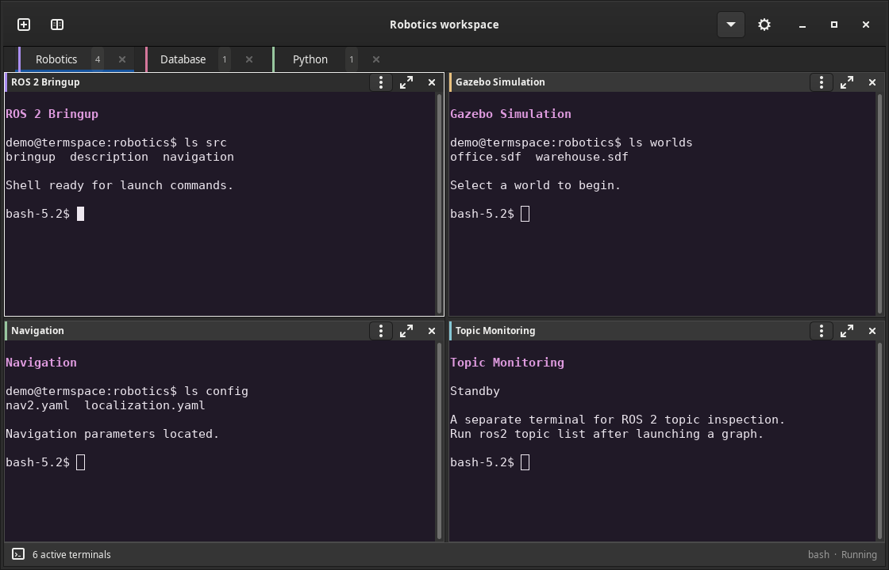

# TermSpace

TermSpace is a native Ubuntu terminal workspace manager built with Python, PyGObject, GTK 4 and VTE. Each pane runs a real shell on an independent Linux PTY. The application works offline and has no account, telemetry, update service or network listener.



The running GTK application with a four-pane layout and demonstration terminal output.

## Install on Ubuntu 24.04 LTS

Download `termspace_1.0.0_all.deb` and `termspace_1.0.0_all.deb.sha256` from the [v1.0.0 release](https://github.com/ishafayetul/TermSpace/releases/tag/v1.0.0). Run the following commands in the download directory. For a local build, use the `dist/` directory.

```bash
sha256sum -c termspace_1.0.0_all.deb.sha256
sudo apt update
sudo apt install ./termspace_1.0.0_all.deb
termspace
```

Remove the package with `sudo apt remove termspace`. Normal removal leaves your XDG configuration and workspace files in your home directory. TermSpace does not register itself as your default terminal.

## Develop and build

On Ubuntu, install the system bindings if needed.

```bash
sudo apt update
sudo apt install python3 python3-gi python3-gi-cairo gir1.2-gtk-4.0 gir1.2-vte-3.91
scripts/check_dependencies.sh
scripts/run_dev.sh
/usr/bin/python3 -m unittest discover -s tests -v
scripts/build_deb.sh
```

Use the system Python for the GI bindings. Run native tests from a test display. See [Testing](docs/TESTING.md) for the X11 and Wayland commands and release evidence.

```bash
termspace --new-window
termspace --working-directory ~/projects
termspace --workspace Robotics
termspace --version
termspace --help
```

Opening from the CLI or automatic restore skips startup commands. The GUI refuses to run as root. A normal user can still initiate elevated commands inside their shell.

## First workspace

1. Open TermSpace and press **Ctrl+Shift+D** to split the first pane side by side.
2. Use each pane's menu to name it. Drag the divider to adjust the layout.
3. Press **Ctrl+Shift+S** to save the window as a workspace.
4. Open the header menu and choose **Manage workspaces** to reopen or export it.

## Windows, tabs and panes

- Use the header bar to open tabs, split the active pane, configure settings, or open a new window in a directory.
- Right-click a tab to rename it, change its accent, duplicate its layout, move it to a new window, save it as a workspace, or close tabs. Drag tabs to reorder them.
- Use a pane's menu for copying, reviewed paste, searching, renaming, editing startup commands, splitting, moving or swapping, clearing scrollback and resetting the terminal.
- Drag split dividers to resize panes. Maximizing, swapping and moving panes preserve their running shells. Duplicating creates new sessions.
- Settings include dark, light and system appearance, eight terminal color schemes, font and cursor profiles, optional headers, optional status text and adjustable resource limits.

## Workspaces and profiles

Save the current window or an individual tab as a workspace. Manage workspaces from the header menu. Open in the current window or a new window, update, rename, duplicate, delete, export, import or make a workspace the default. The [robotics example](docs/examples/robotics.json) provides four panes for ROS 2 Bringup, Gazebo Simulation, Navigation and Topic Monitoring.

Workspaces capture tree structure, split ratios, names, accents, shell profile references, directories and window dimensions. Layout restoration creates fresh PTYs. Saved shell profiles can configure executable, arguments, initial directory, fonts, ANSI colors, cursor, scrollback, bell, accents and environment overrides. Built-in Bash, Zsh and Fish profiles appear when the corresponding executables are available.

Imported workspaces use Default Shell and discard startup commands and any recognized per-pane trust flags. The import review shows the directories that would be used when a workspace is opened. Exports may contain commands and local paths. Profile definitions stay local. When a local workspace contains startup commands, the opening dialog shows the exact script, target pane, directory, shell and arguments. You can skip execution, cancel, or approve that single opening. An authorized script occupies its pane until it exits.

## Keyboard shortcuts

| Shortcut | Action |
| --- | --- |
| Ctrl+Shift+N / T | New window / tab |
| Ctrl+Shift+D / E | Split left/right / top/bottom |
| Ctrl+Shift+W / R / M | Close / rename / maximize or restore pane |
| Ctrl+Shift+C / V / F | Copy / reviewed paste / search |
| Ctrl+Shift+S | Save workspace |
| Ctrl+Tab / Ctrl+Shift+Tab | Next / previous tab |
| Alt+Arrow | Focus a pane in that direction |
| Ctrl+Plus / Minus / 0 | Increase / decrease / reset font size |
| F11 | Toggle fullscreen |

Shortcuts are editable in Settings. TermSpace reserves terminal control keys and rejects duplicate bindings. Shift+Insert and middle-click review the primary selection, and Ctrl+Shift+Insert reviews the regular clipboard. Search defaults to literal matching. Simple regex search is bounded and supports case sensitivity and next/previous results.

## Configuration and security

| Location | Contents |
| --- | --- |
| `$XDG_CONFIG_HOME/termspace/catalog.json` | Preferences, local profiles and workspaces |
| `$XDG_STATE_HOME/termspace/layout.json` | Last closed window layout, when enabled |

The defaults are `~/.config/termspace` and `~/.local/state/termspace`. TermSpace expects mode `0700` on its directories and `0600` on private files. It preserves files that fail access or JSON checks. If a configuration is corrupt, exit TermSpace and move the affected file to a backup path before reopening. If the system GTK/VTE libraries are missing, run the dependency checker and use Ubuntu's package manager.

TermSpace is a native terminal emulator, not a sandbox. Commands run with the shell user's permissions. The application cannot protect against compromised system libraries, shell configuration, or commands the user chooses to run. See [Security](SECURITY.md) for the threat model, reporting and update procedure.

## Known limits

- A detached background job can survive terminal closure. Workspace restore does not reconnect running jobs, SSH sessions or tmux servers.
- The paste guard reserves middle-click within the terminal. VTE still provides X11/Wayland primary selection when the user selects terminal text.
- Search supports literal text and a subset of regular expressions. VTE searches at most one match per wrapped logical line.
- Hyperlink handling is off by default. When enabled, Ctrl+click reviews an OSC 8 HTTP or HTTPS destination before opening the system browser.
- Window placement follows the compositor. Session restore saves the most recently closed window layout when enabled.
- Ubuntu 24.04 is the supported baseline. Retest VTE clipboard and lifecycle behavior before releasing on another version.

## License

TermSpace original code and artwork are MIT licensed. See [LICENSE](LICENSE) and [third-party notices](THIRD_PARTY_NOTICES.md).

## Contributing

See [CONTRIBUTING.md](CONTRIBUTING.md) for development, testing and bug reports. Follow [SECURITY.md](SECURITY.md) for vulnerability reports.
